## 1. Lectura del model conceptual

Del PDF extraiem els elements següents.

**Entitats (5):** `PERSONATGE`, `HABILITAT`, `ENEMIC`, `MASCOTA`, `ITEM`.

**Relacions (7):**

| Relació | Entitats | Cardinalitat al PDF |
|---|---|---|
| Posseeix | Personatge – Habilitat | M:N |
| Enfrenta | Personatge – Enemic | M:N |
| Enfrenta | Habilitat – Enemic | M:N |
| Combina amb | Habilitat – Habilitat (reflexiva) | M:N |
| Acompanya | Personatge – Mascota | 1:1 |
| Equipa | Personatge – Item | M:N |
| Carrega | Mascota – Item | sense cardinalitat al PDF (vegeu supòsits) |

**Convencions del PDF que fem servir:**

- Atribut **subratllat** → clau primària (`PK`).
- Atribut amb **punt groc** → obligatori (`"NOT NULL"`).
- Atribut **compost** (`Mesures` → X, Y, Z) → es descompon en atributs simples.

---

## 2. Construcció pas a pas

### Pas 1 – Les entitats

Segons la guia, cada entitat es defineix amb el seu nom en majúscules.

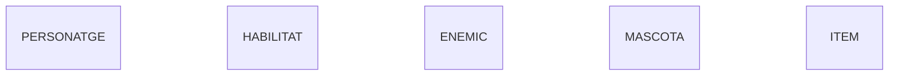

### Pas 2 – Atributs, claus primàries i atributs no nuls

Dins de les claus `{}` de cada entitat afegim els atributs amb el seu tipus de dada. La clau primària porta `PK` i els atributs amb punt groc porten `"NOT NULL"` al final (convenció de la guia).

Per evitar problemes de compatibilitat, els noms d'atribut no porten accents ni punts (`Força` → `Forca`, `Num.Chip` → `Num_Chip`).

**PERSONATGE** – `DNI` és la clau primària; `Nom` és obligatori.

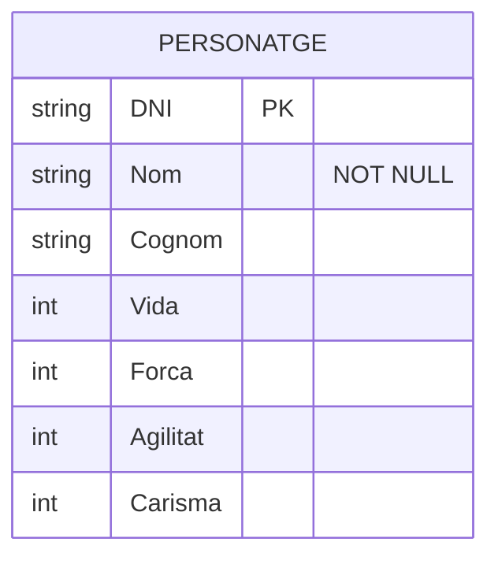

**HABILITAT** – `Codi` és la PK; `Nom` i `Tipus` són obligatoris.

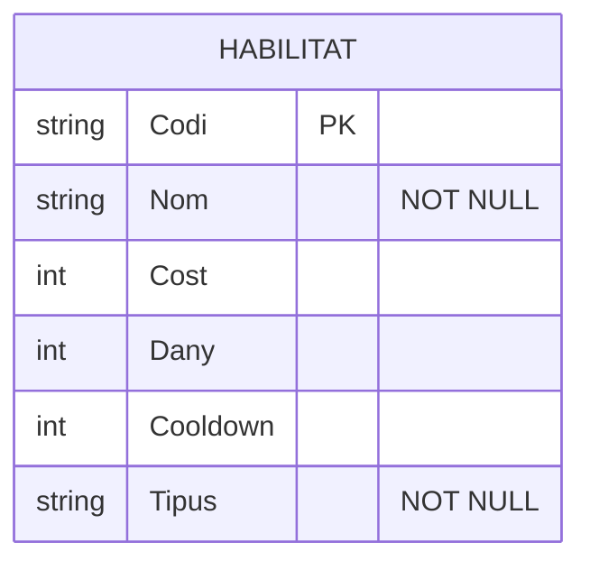

**ENEMIC** – `Codi` és la PK; `Nom`, `Tipus` i `Nivell` són obligatoris.

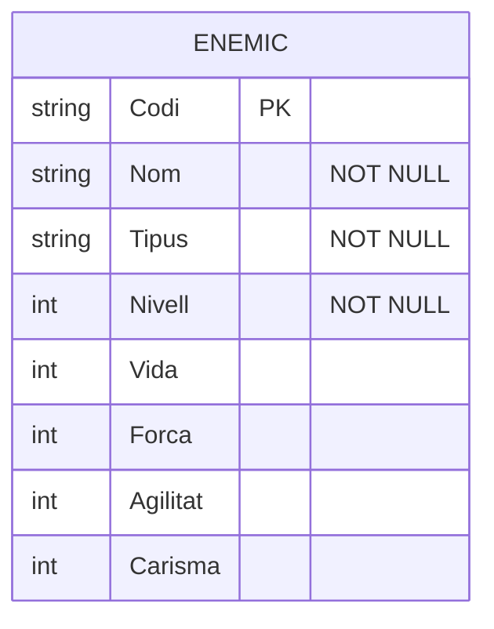

**MASCOTA** – `Num_Chip` és la PK; `Nom` és obligatori.

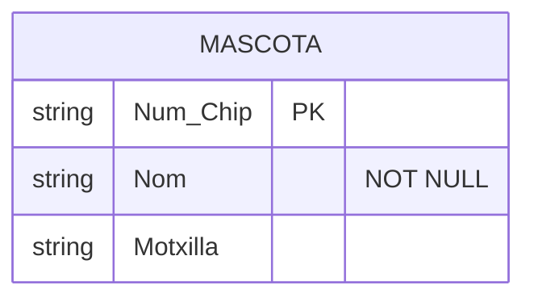

**ITEM** – `Codi` és la PK; `Nom`, `Tipus`, `Comerciable`, `Pes`, `Qualitat` i les mesures són obligatoris.

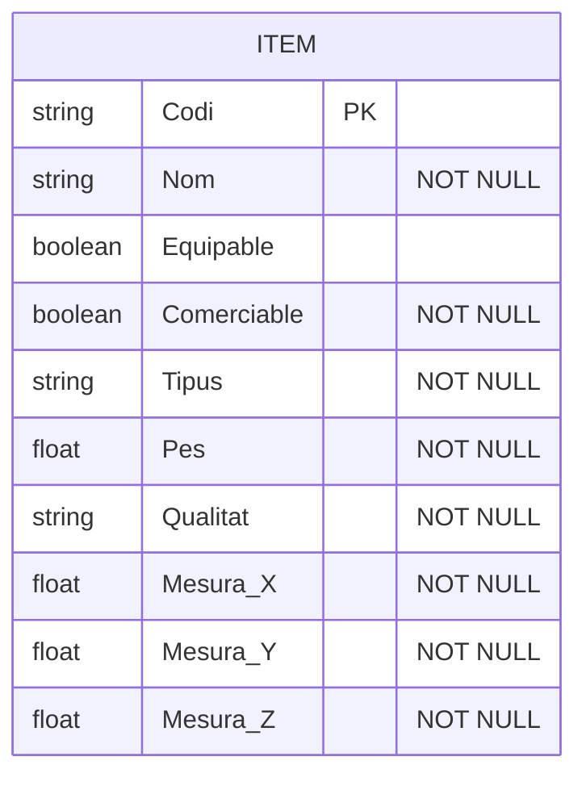

> **Atribut compost `Mesures`:** Mermaid no té sintaxi per a atributs compostos, així que, tal com indica la guia, el substituïm pels seus components com a atributs simples: `Mesura_X`, `Mesura_Y` i `Mesura_Z`. Com que el punt groc era al compost `Mesures`, tots tres components són `"NOT NULL"`.

### Pas 3 – Les relacions i la cardinalitat

La guia fa servir aquests símbols a cada extrem de la línia:

```
|o : zero o un      || : exactament un      }o : zero o molts      }| : un o molts
```

Al PDF totes les relacions es dibuixen amb **línia simple**, és a dir, **participació parcial** (cap entitat està obligada a participar-hi). Per això fem servir les variants "zero o…" a tots dos extrems (`}o`, `o{`, `|o`, `o|`).

**3.1 Relacions M:N** (`}o--o{`). Una instància pot relacionar-se amb moltes de l'altra i viceversa. Cap relació del PDF té atributs propis, així que no cal crear entitats associatives; es deixen com a M:N directes (en passar al model relacional es convertiran en taules intermèdies).

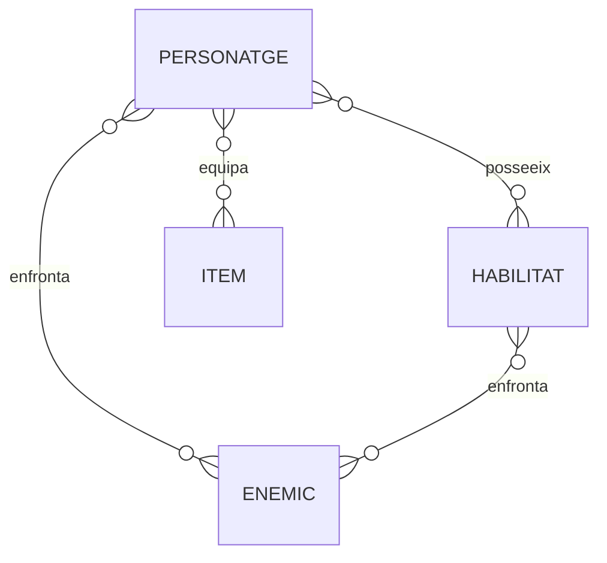

**3.2 Relació reflexiva `Combina amb`.** Una habilitat es combina amb altres habilitats (M:N sobre la mateixa entitat). Com que l'etiqueta té espais, va entre cometes.

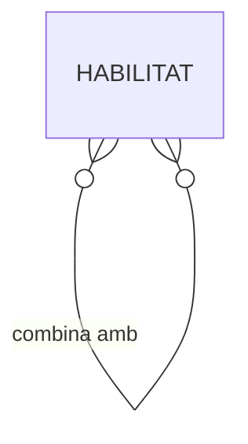

**3.3 Relació 1:1 `Acompanya`.** Un personatge és acompanyat com a màxim per una mascota, i una mascota acompanya com a màxim un personatge.

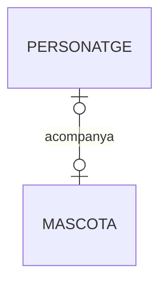

**3.4 Relació 1:N `Carrega`.** Una mascota pot carregar zero o molts ítems; un ítem és carregat com a màxim per una mascota (vegeu supòsits).

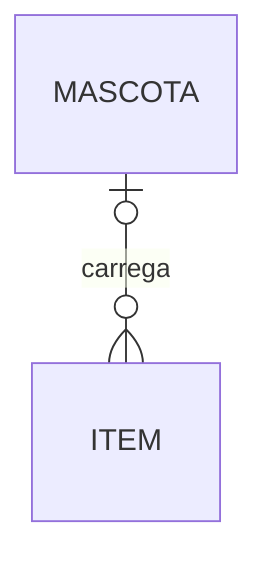

---

## 3. Diagrama E/R complet

```mermaid
erDiagram
    %% ===== ENTITATS I ATRIBUTS =====
    PERSONATGE {
        string DNI PK
        string Nom "NOT NULL"
        string Cognom
        int Vida
        int Forca
        int Agilitat
        int Carisma
    }

    HABILITAT {
        string Codi PK
        string Nom "NOT NULL"
        int Cost
        int Dany
        int Cooldown
        string Tipus "NOT NULL"
    }

    ENEMIC {
        string Codi PK
        string Nom "NOT NULL"
        string Tipus "NOT NULL"
        int Nivell "NOT NULL"
        int Vida
        int Forca
        int Agilitat
        int Carisma
    }

    MASCOTA {
        string Num_Chip PK
        string Nom "NOT NULL"
        string Motxilla
    }

    ITEM {
        string Codi PK
        string Nom "NOT NULL"
        boolean Equipable
        boolean Comerciable "NOT NULL"
        string Tipus "NOT NULL"
        float Pes "NOT NULL"
        string Qualitat "NOT NULL"
        float Mesura_X "NOT NULL"
        float Mesura_Y "NOT NULL"
        float Mesura_Z "NOT NULL"
    }

    %% ===== RELACIONS =====
    PERSONATGE }o--o{ HABILITAT : posseeix
    PERSONATGE }o--o{ ENEMIC : enfronta
    HABILITAT }o--o{ ENEMIC : enfronta
    HABILITAT }o--o{ HABILITAT : "combina amb"
    PERSONATGE |o--o| MASCOTA : acompanya
    PERSONATGE }o--o{ ITEM : equipa
    MASCOTA |o--o{ ITEM : carrega
```
