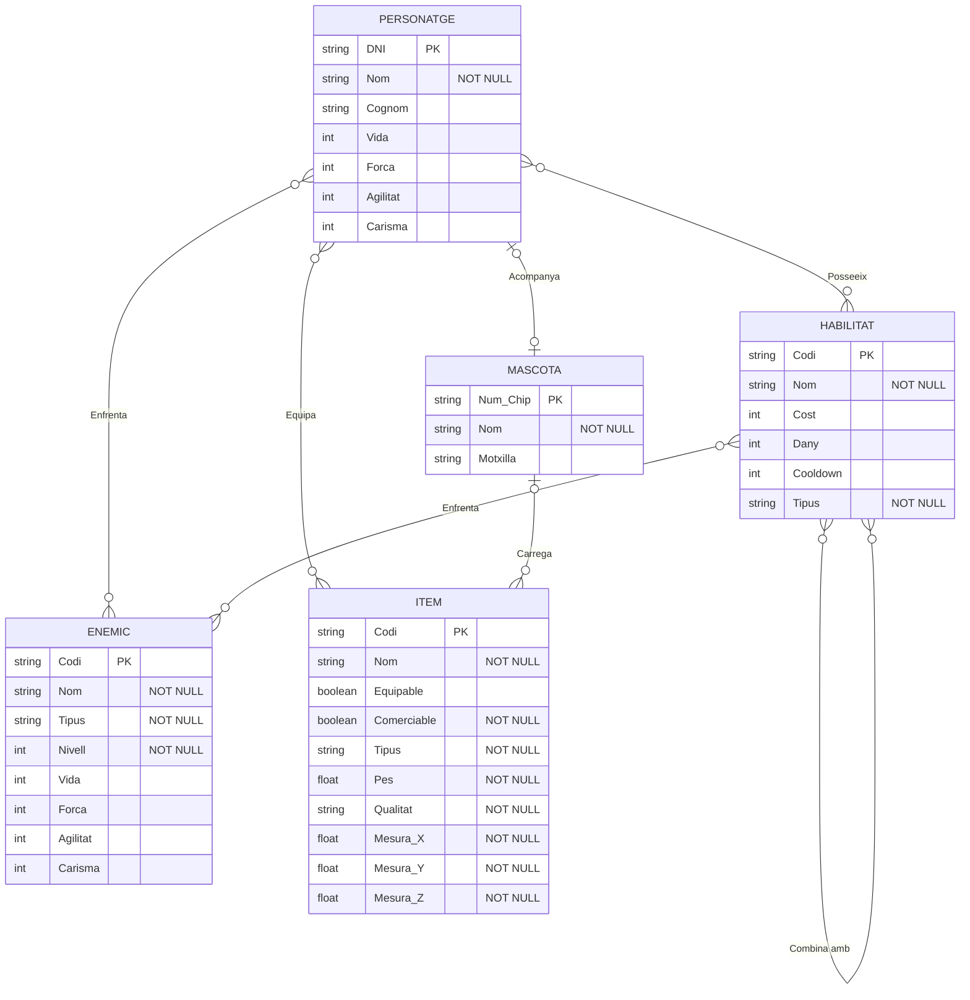

### Iker Burgos Lorente    1rASIX    26/10/2026 

## 1. Diagrama E/R complet

## Explicació mermaid
# Explicación del modelo entidad-relación (Mermaid)

## 1. Entidades

### PERSONATGE
Representa a los personajes del juego. Tiene **DNI** como clave primaria (PK), que lo identifica de forma única. El **Nom** es obligatorio (NOT NULL), mientras que el **Cognom** es opcional. Además, guarda las estadísticas numéricas del personaje: **Vida, Força, Agilitat y Carisma**.

### HABILITAT
Representa las habilidades que pueden tener los personajes. La clave primaria es el **Codi**. El **Nom** y el **Tipus** son obligatorios. También tiene tres datos numéricos: el **Cost** (lo que cuesta utilizarla), el **Dany** (el daño que causa) y el **Cooldown** (el tiempo de espera antes de volver a utilizarla).

### MASCOTA
Representa el animal de compañía de un personaje. La clave primaria es el **Num_Chip**, único para cada mascota. El **Nom** es obligatorio y la **Motxilla** es un campo opcional que indica lo que lleva.

### ENEMIC
Representa a los enemigos del juego. La clave primaria es el **Codi**. El **Nom**, el **Tipus** y el **Nivell** son obligatorios. Igual que el personaje, tiene las estadísticas **Vida, Força, Agilitat y Carisma**, que son opcionales.

### ITEM
Representa los objetos del juego. La clave primaria es el **Codi**. Todos los atributos son obligatorios excepto **Equipable** (que indica si el objeto se puede equipar). Los atributos obligatorios son:

- **Nom**
- **Comerciable** (si se puede vender o intercambiar)
- **Tipus**
- **Pes**
- **Qualitat**
- **Mesura_X, Mesura_Y y Mesura_Z** (las dimensiones del objeto)

## 2. Conexiones entre entidades

### Posseeix (PERSONATGE – HABILITAT, M:N)
Un personaje puede tener muchas habilidades y una misma habilidad puede ser poseída por muchos personajes. Los círculos indican que la participación es opcional: un personaje puede no tener ninguna habilidad y una habilidad puede no estar asignada a ningún personaje.

### Combina amb (HABILITAT – HABILITAT, M:N reflexiva)
Es una relación de la entidad consigo misma. Una habilidad se puede combinar con muchas otras habilidades y, a la vez, puede formar parte de las combinaciones de otras. Sirve para representar combinaciones (combos) de habilidades.

### Enfrenta (HABILITAT – ENEMIC, M:N)
Una habilidad se puede utilizar contra muchos enemigos, y un enemigo puede ser enfrentado con muchas habilidades diferentes.

### Enfrenta (PERSONATGE – ENEMIC, M:N)
Un personaje se puede enfrentar a muchos enemigos, y un mismo enemigo puede ser enfrentado por muchos personajes. La participación es opcional en ambos lados.

### Acompanya (PERSONATGE – MASCOTA, 1:1)
Un personaje puede ser acompañado como máximo por una mascota, y una mascota solo acompaña a un personaje. Como hay círculos, un personaje puede no tener mascota y una mascota puede no tener dueño.

### Carrega (MASCOTA – ITEM, 1:N)
Una mascota puede cargar muchos ítems, pero un ítem solo puede ser cargado por una única mascota. Puede haber mascotas sin ningún ítem e ítems que no lleve ninguna mascota.

### Equipa (PERSONATGE – ITEM, M:N)
Un personaje puede equipar muchos ítems, y un mismo ítem puede ser equipado por muchos personajes. Esta relación se vincula con el atributo *Equipable* del ítem.
